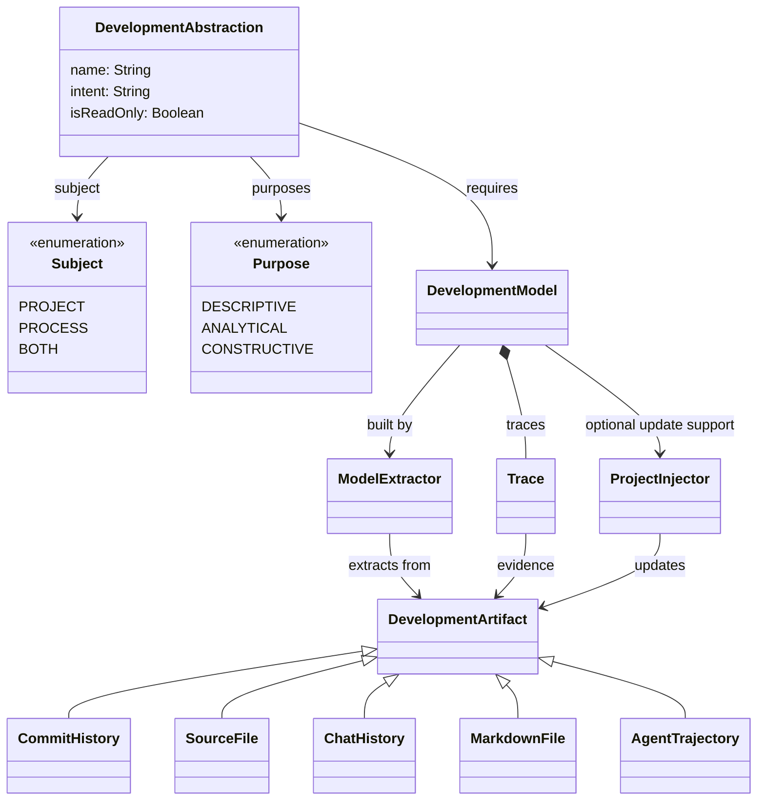

# Catalogue of development abstractions

This catalogue introduces development abstractions for **abstraction-augmented agentic development (A³D)**: helping people understand and steer software development carried out with coding agents.

A **development abstraction** is a structured, task-oriented representation that selectively exposes relevant aspects of a software project or its development process. It may be visual and interactive. A **development model** supplies the information used by one or more abstractions, with traces to supporting evidence. Separating models from abstractions allows extraction to be reused across different views.

The initial catalogue expands the ten example abstractions in Table I and the seven development models described in the accompanying article, *Abstraction-Augmented Agentic Development*. Entries describe concepts and illustrative interactions; they do not claim that all capabilities have been implemented or empirically validated. The catalogue is independent of a particular coding agent, development methodology, or plugin format.

## Conceptual model

The following Markdown-native adaptation of Figure 1 captures its central concepts and relationships. It simplifies the diagram layout and association multiplicities.

An abstraction requires one or more development models; each model can serve multiple abstractions. Extractors locate relevant information in development artefacts and populate models. Traces connect model information to its supporting evidence. Extractors may use configured algorithms, language models, or a combination of both.

An abstraction has a project, process, or combined subject and one or more purposes: **descriptive** (present selected information), **analytical** (derive findings), or **constructive** (express intended changes). Read-only abstractions can still support interaction and navigation. Editable abstractions delegate changes to models; where supported, project injectors propagate those changes to the corresponding artefacts.

For example, an extractor identifies requirements and tasks in Markdown specifications and records their relationships in a project model. A project map displays those relationships as a graph, while project cards display the same items as a dashboard. Both navigate back to the supporting sources.

## Development abstractions

The following table provides the initial catalogue. Model dependencies follow Table I; implementations can use additional models for navigation or enrichment.

| Abstraction | Developer question | Subject | Purpose | Required models |
| --- | --- | --- | --- | --- |
| [Project map](abstractions/project-map.md) | Which tasks implement requirement X? Which design decisions address it? | Project | Descriptive | [Project model](models/project.md) |
| [Project cards](abstractions/project-cards.md) | Where is requirement X defined or mentioned? What is its status and where was it set? | Project | Descriptive | [Project model](models/project.md) |
| [Evidence coverage](abstractions/evidence-coverage.md) | Are there gaps in documented evidence of achieved objectives? | Project | Analytical | [Project model](models/project.md), [Code model](models/code.md), [Physical model](models/physical.md) |
| [Feature dossier](abstractions/feature-dossier.md) | What is feature X about? | Project | Descriptive | [Project model](models/project.md), [Physical model](models/physical.md) |
| [Implementation traceability](abstractions/implementation-traceability.md) | Where is requirement X implemented? | Project | Descriptive | [Project model](models/project.md), [Physical model](models/physical.md), [History model](models/history.md), [Code model](models/code.md) |
| [Domain model](abstractions/domain-model.md) | What are the domain concepts, properties, and relations underlying the application? | Project | Descriptive, constructive | [Semantic model](models/semantic.md) |
| [User stories](abstractions/user-stories.md) | What user journeys are defined in the system? | Project | Descriptive, constructive | [Semantic model](models/semantic.md) |
| [State machines](abstractions/state-machines.md) | How does component X behave? | Project | Descriptive, constructive | [Semantic model](models/semantic.md) |
| [Evolution timeline](abstractions/evolution-timeline.md) | How did the project reach its current state? | Project and process | Descriptive, analytical | [Project model](models/project.md), [History model](models/history.md), [Code model](models/code.md), [Physical model](models/physical.md) |
| [Agent activity map](abstractions/agent-activity-map.md) | What is the agent doing, and where is it struggling? Is file X being read or written? Is tool X used routinely? | Process | Descriptive, analytical | [Agent activity model](models/agent-activity.md), [Chat model](models/chat.md) |

Each entry describes the developer question, representation and interaction, information and evidence, an illustrative example, and limitations. Constructive purposes describe intended editing capabilities, rather than a guarantee of editing support in any tool.

## Development models

| Model | Information represented |
| --- | --- |
| [Project model](models/project.md) | Specification items and their relationships, organisation, and stated progress. |
| [Physical model](models/physical.md) | The project’s file and folder structure and the locations of supporting artefacts. |
| [Semantic model](models/semantic.md) | Domain and behavioural concepts expressed in diagrams or other structured descriptions. |
| [Code model](models/code.md) | The implementation’s structural elements and dependencies. |
| [History model](models/history.md) | Repository evolution through revisions, changes, and development events. |
| [Agent activity model](models/agent-activity.md) | Observable activity during coding-agent work sessions. |
| [Chat model](models/chat.md) | Human-agent conversations from development sessions. |

Each model entry describes its core information, sources and extraction, evidence and refresh, relationships to other models, consuming abstractions, and limitations. These descriptions are conceptual and do not prescribe a formal schema or persistence format.

## Reading and extending the catalogue

Start with the developer question closest to your task, then follow the required-model links to understand its information needs. The catalogue is representative and open to extension. New abstractions should identify a concrete developer question, explain what they expose or allow a person to change, and state how their information traces to evidence. New models should explain what information they contribute and how it can be reused.

A catalogue entry describes a concept; an extractor or plugin is an implementation of that concept. Distinguish documented facts from inferred findings, and identify missing or stale evidence rather than presenting it as certainty.
