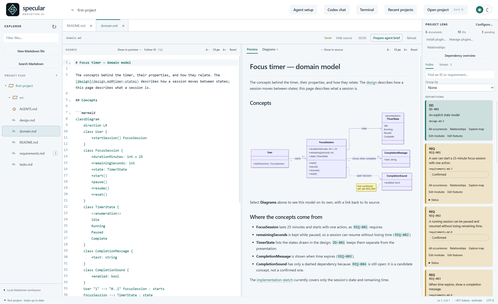
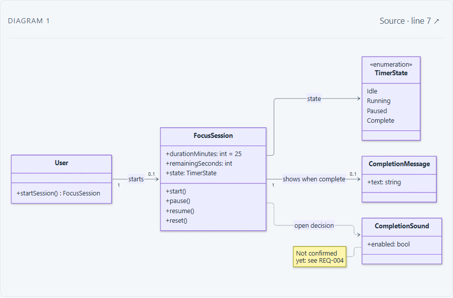

# Domain model

[Catalogue](../README.md)

A class diagram representing domain concepts, attributes, and relationships.

| Property | Description |
| --- | --- |
| Subject | Project |
| Purpose | Descriptive, constructive |
| Required models | [Semantic model](../models/semantic.md) |

## Developer question

What are the domain concepts, properties, and relations underlying the application?

## Representation and interaction

Concepts, their attributes, and the relationships between them are drawn as a class diagram, built from the domain 
described in the specifications (or extracted from code). Developers select concepts and relationships to inspect 
their sources. In an editable implementation, they can also change model elements in the diagram and review the 
corresponding edits to the specifications or code before applying them. For example, a diagram relates Project, 
Requirement, and Task; a developer adds an owner property to Task and reviews the corresponding diagram-source change.

## Information and evidence

Diagram elements and relationships, source mappings, and, for editing, a supported notation and update policy. The 
view should preserve navigation to supporting evidence and make unavailable information explicit.

## Limitations

A domain concept need not correspond directly to an implementation class. Constructive use requires an injector; 
viewing a diagram does not imply editing support.

## Known implementations

### Mermaid class diagrams (specular)

[specular](https://github.com/specular-ai/specular) implements a **read-only** version: it renders the class 
diagrams that are written in the specifications as Mermaid `classDiagram` blocks, in the same way as the 
[state machines](state-machines.md). It does not yet build a semantic model, so it shows only the concepts the 
authors drew, and the diagram cannot be edited directly: changing the domain model means editing the Mermaid text, 
after which the diagram updates as you type.

The figures below show the *first-project* example, a focus timer. Its `domain.md` describes the timer's concepts: a 
User starts a FocusSession, which has a duration, the remaining time, and a TimerState (Idle, Running, Paused, 
Complete), and shows a CompletionMessage when time expires. A CompletionSound is attached only by a dashed dependency 
and a note, because the requirement that would introduce it (REQ-004) is still open. Below the diagram, the document 
explains where each concept comes from; the requirement and decision IDs it mentions (REQ-001 to REQ-004, DD-001) 
link to their definitions.

The *Diagrams* view shows the class diagram on its own, with a link back to the source line where it is written.

Compared with the full abstraction, classes, attributes, and associations cannot be selected to inspect evidence: 
the links between concepts and requirements exist only in the surrounding prose, not in the diagram. The model is not 
checked against the code (in the example, `src/timer.ts` covers only the session's state and remaining time), and 
nothing drawn in the diagram is propagated to other artefacts.
