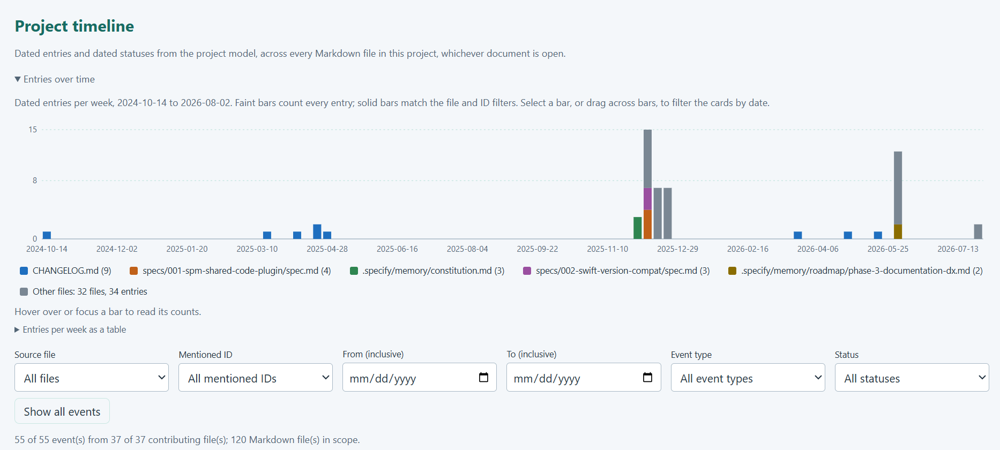
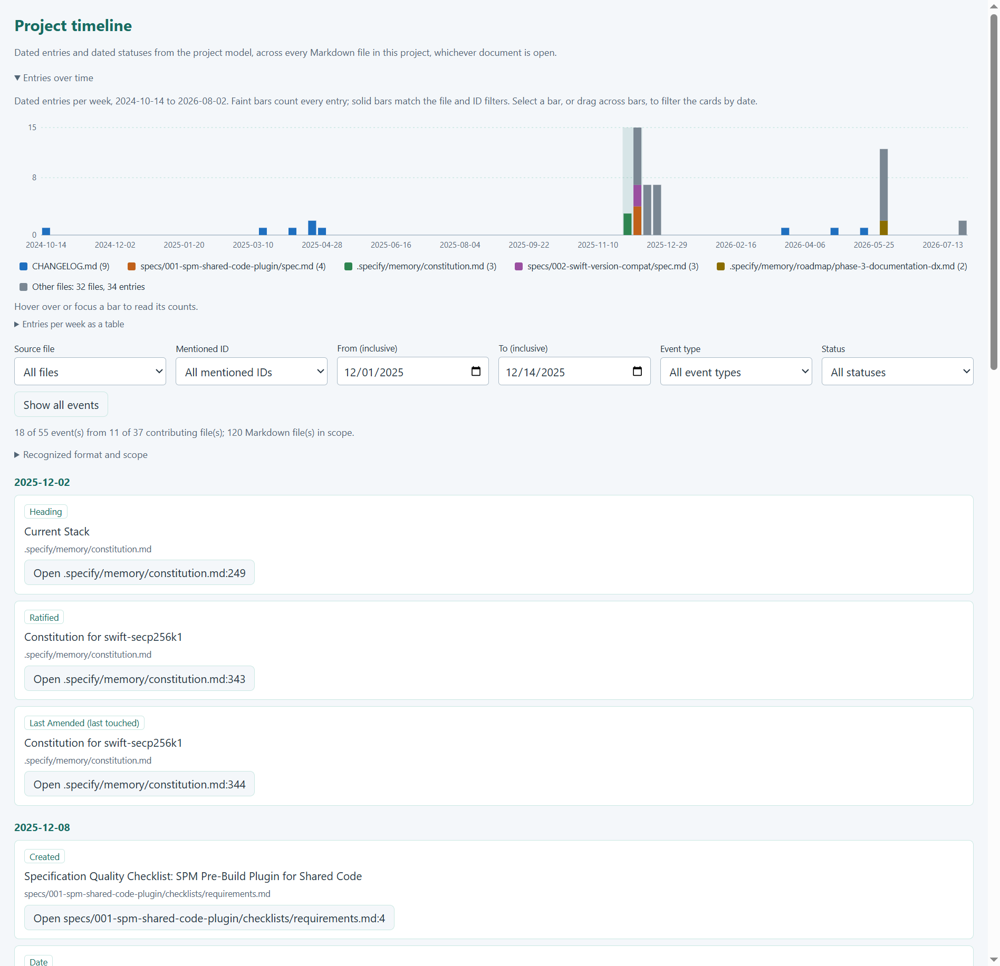

# Evolution timeline

[Catalogue](../README.md)

A timeline connecting development events (History) and decisions (Project) with changes to the project (Code and 
Physical).

| Property | Description |
| --- | --- |
| Subject | Project and process |
| Purpose | Descriptive, analytical |
| Required models | [Project model](../models/project.md), [History model](../models/history.md), [Code model](../models/code.md), [Physical model](../models/physical.md) |

## Developer question

How did the project reach its current state?

## Representation and interaction

Events are placed on a time axis: revisions and other development events from the history model, decisions and 
dated records from the project model, and the changes to specification files and code declarations they involve. 
Developers filter by time, feature, or artefact; compare revisions; and inspect the changed items and the decisions 
that support them. For example, a timeline could show when REQ-001 was introduced, the decision to require 
confirmation (DD-001), the commits that changed the reservation code, and the later completion of TASK-001.

## Information and evidence

Revision metadata, file and declaration changes, and links to project items or documented decisions. The view should 
preserve navigation to supporting evidence and make unavailable information explicit.

## Limitations

Commit order records repository evolution, which may differ from when decisions were made. Do not infer undocumented 
rationale from a change alone.

## Known implementations

### Project timeline (specular)

[specular](https://github.com/specular-ai/specular) implements a simplified version, the *project timeline*, as a 
plugin. It uses only the [project model](../models/project.md), plus the [physical model](../models/physical.md) for 
file counts and line numbers. Without the history and code models it shows the dates *written in* the specifications, 
not commits or code changes, so it answers a narrower question: what do the specifications record as having happened, 
and when?

The figures below show it on [swift-secp256k1](https://github.com/21-DOT-DEV/swift-secp256k1), a Spec Kit project 
(120 Markdown files), with the configuration derived by specular's extractor agent. The timeline collects 55 dated 
events from 37 files. It shows four kinds of event, each found by a configurable date rule:

- **Recorded entries:** list items that begin with a date, such as `- 2026-09-15: Added the first timeline view.`
- **Dated statuses:** authored statuses of IDs that contain a date, such as `Status: Implemented on 2026-10-13`.
- **Milestones:** headings with a date, such as a release `## [0.23.2] - 2026-05-22`, and labelled fields such as 
  `**Created**: 2025-12-12` or `**Ratified**: 2025-12-02`.
- **Last-updated dates:** fields such as `**Last Amended**: 2025-12-02`, shown as "last touched", since they record 
  only the latest change to a document.

A histogram of entries over time sits above the event list. Bars count entries per day, week, or month, depending on 
the span, and are stacked by source file: the five files with the most entries have their own colour and the rest 
are grouped as *Other files*. In the figure below, the CHANGELOG's releases are spread over 2024–2026, while most 
specification activity is concentrated in December 2025 (the constitution and the first two feature specifications). 
The tall bar in June 2026 is a single revision of the roadmap: every roadmap document has *Last Updated: 2026-06-05*.

The histogram drives the filters below it: clicking a bar or dragging across bars selects a date range, and clicking 
a legend entry shows only that file. The filters (source file, mentioned ID, date range, event type, and status) 
combine, and a summary always reports how many of all events and files match, so a filtered list never reads as the 
whole project. Events are grouped by day; each shows its kind (e.g., *Heading*, *Ratified*, *Created*), the heading 
or document title, its file, and a button that opens the exact source line. In the figure below, the first two weeks 
of December 2025 are selected: 18 of the 55 events, from 11 files, starting with the project constitution.

Compared with the full abstraction, the project timeline does not show commits or code changes, cannot compare 
revisions, and does not connect events to the code they affected. Its dates are what the documents state: a missing 
date is not evidence that nothing happened, and a dated status records what a specification claims, not verified 
delivery.
