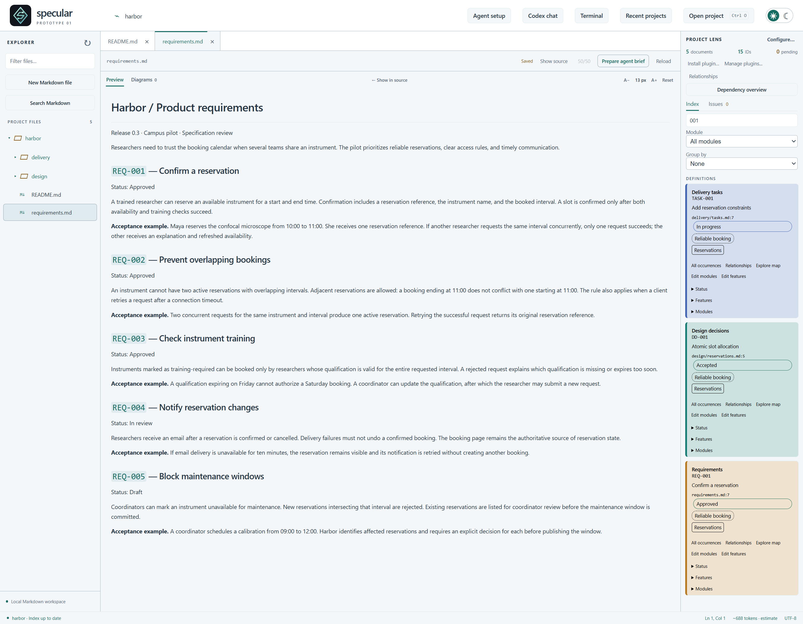
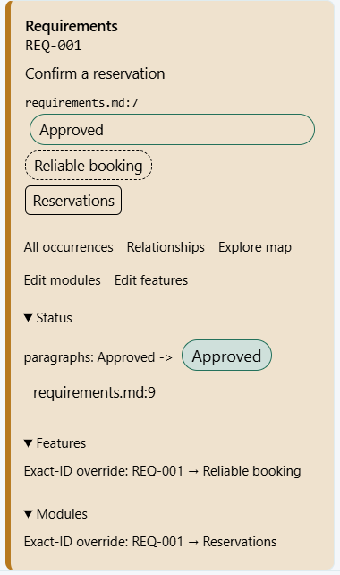
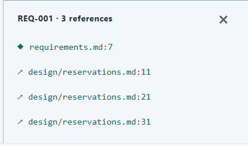

# Project cards

[Catalogue](../README.md)

A dashboard of cards with ID details: each card shows an ID's definition, occurrences, status, features, and modules.

| Property | Description |
| --- | --- |
| Subject | Project |
| Purpose | Descriptive |
| Required models | [Project model](../models/project.md) |

## Developer question

Where is requirement X defined or mentioned? What is its status and where was it set?

## Representation and interaction

The figures below show the Harbor example project, whose requirements, design decisions and delivery tasks are 
written in four Markdown files.

The cards are shown next to the documents, as in the figure below. Searching for `001` returns one card per category 
(a delivery task, a design decision and a requirement), each in its category's colour. Cards can be filtered by 
module and grouped by status, module or feature.

Each card shows the ID's category, its title, and the file and line where it is defined, together with badges for its 
status, features and modules. Expanding a card shows where each of them comes from. In the figure below, REQ-001 is 
*Approved* because of the `Status: Approved` paragraph at `requirements.md:9`, which opens the source document. 
Its feature (*Reliable booking*) and module (*Reservations*) come from assignments in the project configuration, 
which can be changed from the card (*Edit features*, *Edit modules*).

*All occurrences* lists the ID's definition and references, each of which opens the document at that line. REQ-001 
is defined in `requirements.md` and referenced three times in the design decisions. From the card, 
*Relationships* lists the IDs connected to it and *Explore map* opens it in the [project map](project-map.md).

## Information and evidence

ID categories, definition rules, status rules, and feature/module assignments. Statuses are only those written in 
the documents (e.g., a checkbox, a `Status:` field or a status column); none are inferred. The view should preserve 
navigation to supporting evidence and make unavailable information explicit.

## Limitations

Different sources may assign conflicting statuses. Preserve those sources rather than silently choosing one.
An authored status records what the documents claim, not whether the software actually implements it.

## Known implementations

This abstraction is currently implemented in [specular](https://github.com/specular-ai/specular).
