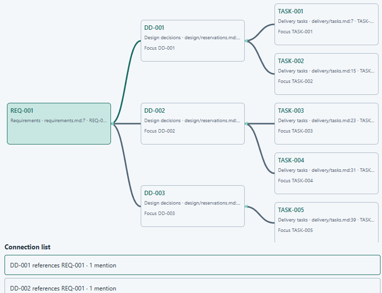
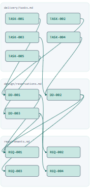

# Project map

[Catalogue](../README.md)

A navigable graph linking IDs (e.g., requirements, design decisions, and implementation tasks) according to 
their relations.

| Property | Description |
| --- | --- |
| Subject | Project |
| Purpose | Descriptive |
| Required models | [Project model](../models/project.md) |

## Developer question

Which tasks implement requirement X? Which design decisions address it?

## Representation and interaction

The abstraction provides a focused view, as shown in the figure below. This allows understanding which IDs are related. 
For example REQ-001 is addressed by three design decisions (DD-001, DD-002 and DD-003), and each of those planned 
for implementation in different tasks.

Additionally, a global overview view represents the entire graph of IDs and relationships.

## Information and evidence

Typed IDs and explicit or configured relationships. Co-occurrence alone should not be presented as a confirmed 
dependency. The view should preserve navigation to supporting evidence and make unavailable information explicit.

## Limitations

A missing edge can mean missing documentation or extraction coverage, rather than a missing implementation.

## Known implementations

This abstraction is currently implemented in specular.
