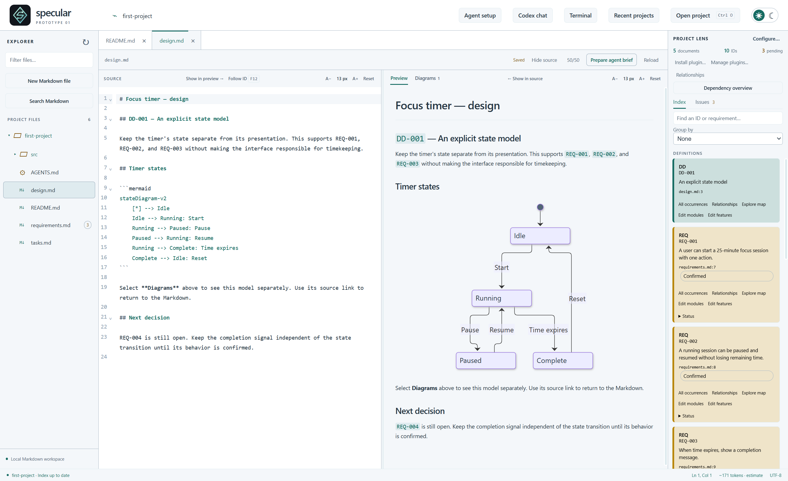
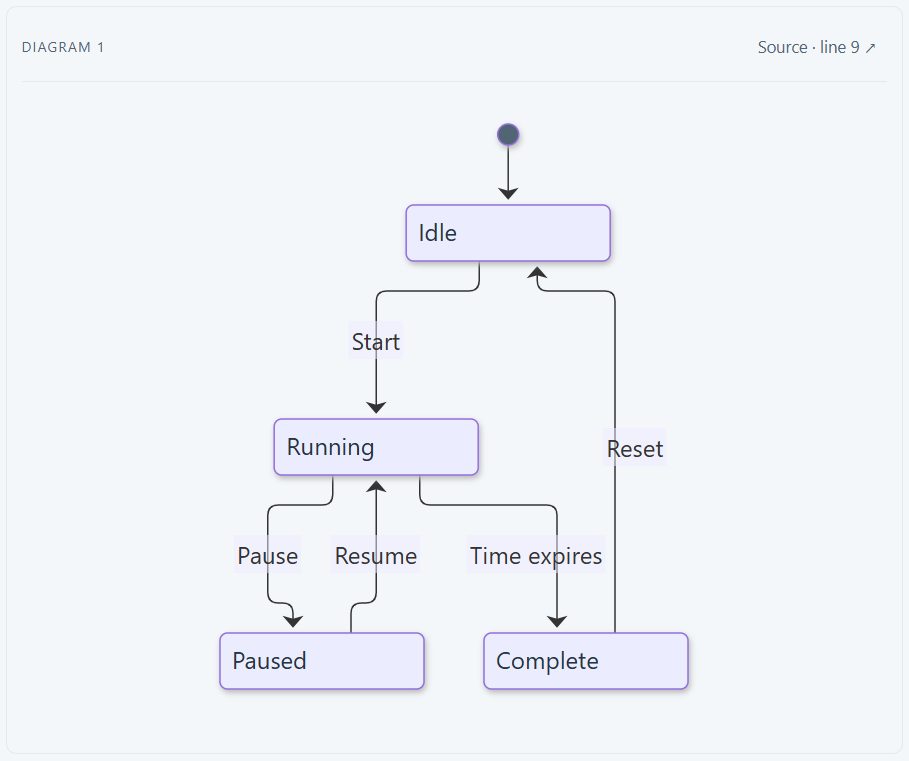

# State machines

[Catalogue](../README.md)

A state machine showing states, transitions, events, and guards.

| Property | Description |
| --- | --- |
| Subject | Project |
| Purpose | Descriptive, constructive |
| Required models | [Semantic model](../models/semantic.md) |

## Developer question

How does component X behave?

## Representation and interaction

States and transitions are drawn as a diagram, built from the behaviour described in the specifications (or extracted 
from code). Developers select states and transitions to inspect their evidence. In an editable implementation, they 
can also change the behaviour in the diagram and review the corresponding edits to the specifications or code before 
applying them. For example, a deletion flow moves from Idle to AwaitingConfirmation, then to Deleted on confirm or 
back to Idle on cancel.

## Information and evidence

State and transition definitions, events and guards where available, and source mappings. The view should preserve 
navigation to supporting evidence and make unavailable information explicit.

## Limitations

Distinguish specified behaviour from behaviour extracted from code. Editing a diagram alone does not reconcile an 
implementation.

## Known implementations

### Mermaid state diagrams (specular)

[specular](https://github.com/specular-ai/specular) implements a **read-only** version: it renders the state 
diagrams that are written in the specifications as Mermaid `stateDiagram` blocks. Rendering is not specific to 
state machines: any Mermaid diagram in a Markdown file (e.g., a flowchart, sequence or class diagram) is shown in the 
same way. It does not yet build a semantic 
model, so it shows only the behaviour the authors drew, and the diagram cannot be edited directly: changing the 
behaviour means editing the Mermaid text, after which the diagram updates as you type.

The figures below show the *first-project* example, a focus timer. Its `design.md` describes the timer's states 
(Idle, Running, Paused, Complete) and the events that move between them (Start, Pause, Resume, Time expires, Reset). 
The diagram is rendered in the document preview, next to its Mermaid source and to the design decision it belongs to 
(DD-001, which supports REQ-001 to REQ-003).

The *Diagrams* view lists every diagram in the current document on its own, each with a link back to the source 
line where it is written.

Compared with the full abstraction, states and transitions cannot be selected to inspect evidence, are not linked to 
the IDs of the requirements they realise, and are not checked against the code. Guards appear only if the authors 
write them as transition labels.
