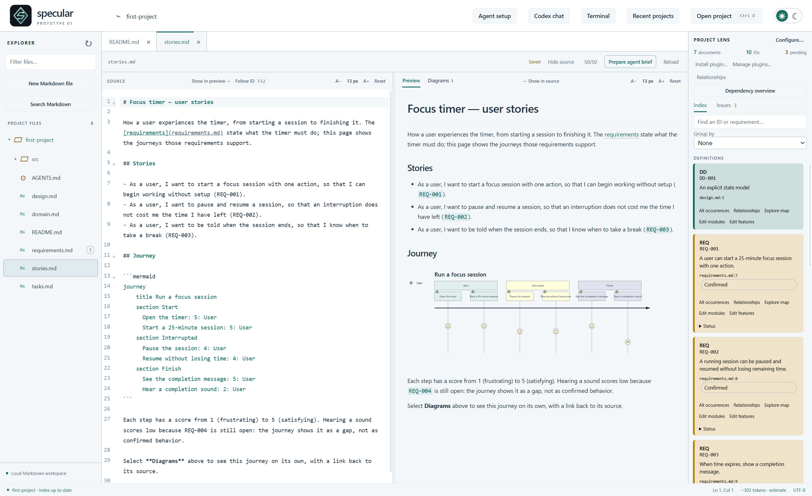
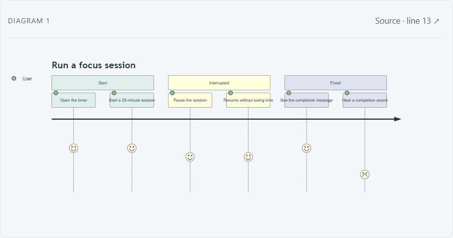

# User stories

[Catalogue](../README.md)

A structured model of user stories and their associated journeys or steps.

| Property | Description |
| --- | --- |
| Subject | Project |
| Purpose | Descriptive, constructive |
| Required models | [Semantic model](../models/semantic.md) |

## Developer question

What user journeys are defined in the system?

## Representation and interaction

Stories and the journeys they describe are shown as a structured model, built from the stories written in the 
specifications. Developers explore stories by actor or goal and inspect the original story text. In an editable 
implementation, they can also revise stories and review the corresponding source updates before applying them. For 
example, an administrator's story describes deleting an obsolete item, including the confirmation step and the 
cancellation alternative.

## Information and evidence

Identifiable stories, actors, goals, journey relationships, and links to their source descriptions. The view should 
preserve navigation to supporting evidence and make unavailable information explicit.

## Limitations

A story model describes intended use. It does not establish that a journey is implemented or tested.

## Known implementations

### Mermaid user journeys (specular)

[specular](https://github.com/specular-ai/specular) implements a **read-only** version: it renders the user journeys 
that are written in the specifications as Mermaid `journey` blocks, in the same way as the 
[domain model](domain-model.md) and the [state machines](state-machines.md). A journey is divided into sections, 
and each step names the actors involved and a satisfaction score from 1 to 5. Mermaid has no notation for the stories 
themselves ("As a ..., I want ..., so that ..."), so they remain ordinary Markdown text next to the diagram. specular 
does not yet build a semantic model, so it shows only the journeys the authors drew, and the diagram cannot be edited 
directly: changing a journey means editing the Mermaid text, after which the diagram updates as you type.

The figures below show the *first-project* example, a focus timer. Its `stories.md` lists three user stories, each 
referring to the requirement it comes from (REQ-001 to REQ-003); these IDs link to their definitions. The journey 
follows a User through three sections: starting a session, pausing and resuming it, and finishing it. The last step, 
hearing a completion sound, scores low because the requirement that would introduce it (REQ-004) is still open, so 
the journey shows it as a gap rather than as confirmed behaviour.

The *Diagrams* view shows the journey on its own, with a link back to the source line where it is written.

Compared with the full abstraction, stories are not identifiable model elements: they cannot be explored by actor or 
goal, and the links between stories, journey steps, and requirements exist only in the surrounding prose. Journey 
steps cannot be selected to inspect evidence, and nothing drawn in the diagram is propagated to other artefacts.
